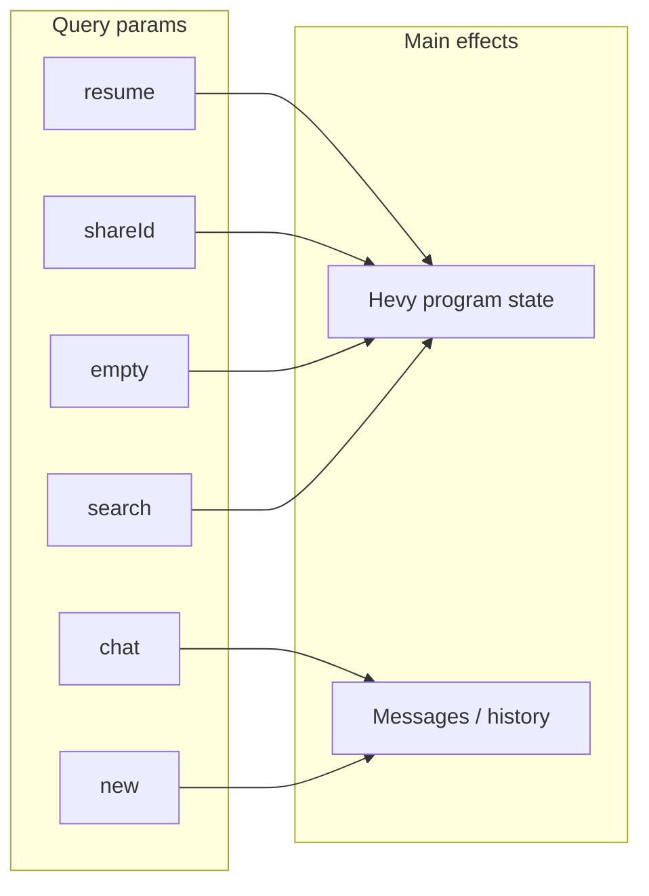

# Build-program URL query parameters reference

## Source of truth

All parameters are read client-side via `useSearchParams()`:

- [`BuildProgram.tsx`](../src/app/(app)/(with-toolbar)/build-program/BuildProgram.tsx) — `shareId`, `resume`, `empty`, `search`
- [`use-build-program-chat.ts`](../src/app/(app)/(with-toolbar)/build-program/use-build-program-chat.ts) — `search`, `shareId`, `chat`, `new`

Shared-program loading uses the same “valid `shareId`” rule as `isBuildProgramShareIdParam` in [`BuildProgram.tsx`](../src/app/(app)/(with-toolbar)/build-program/BuildProgram.tsx) (non-empty, parses to a finite number &gt; 0). [`use-build-program-chat.ts`](../src/app/(app)/(with-toolbar)/build-program/use-build-program-chat.ts) mirrors that logic for the initial-send guard. The legacy `shared` query key is not read; old URLs that still include `shared=true` behave correctly as long as `shareId` is present.

No additional query keys are consumed by the build-program `page.tsx` or `layout.tsx`.

---

### `edit`

- **Status:** Not read by the app today. The `edit` query key is reserved for a future feature. Old bookmarks or links that include `edit=true` or other values have no effect on builder behavior.

### `resume`

- **What it does:** When `resume=true`, loads the in-progress program from `localStorage` key `hevy-program-in-progress` and parses it into editor state. Sets `resumeLoadAttemptedRef`.
- **Edge cases:** If that key is missing or invalid JSON, the program stays empty after the effect’s initial `setHevyProgram([])`. Debounced persistence skips clearing `hevy-program-in-progress` when `resume=true` and the program is still empty (see [`BuildProgram.tsx`](../src/app/(app)/(with-toolbar)/build-program/BuildProgram.tsx) — `localStorage` debounce around `resume === "true"`). Combining with `empty=true` is unsafe: the same effect runs `resume` then **`empty` overwrites** with the empty template.

### `shareId`

- **What it does:** When present and valid (see `isBuildProgramShareIdParam`), [`BuildProgram.tsx`](../src/app/(app)/(with-toolbar)/build-program/BuildProgram.tsx) calls `getSharedProgram(Number(shareId))` and, on success, replaces the editor program. Sets `sharedProgramLoadAttemptedRef` when the fetch finishes (success or not). Also used in sidebar links with `chat` to reopen a program tied to a saved chat ([`AppSidebar.tsx`](../src/components/AppSidebar.tsx) — recent chat links).
- **Edge cases:** Invalid values (empty, non-numeric, zero, or negative) do not trigger a fetch. Async fetch can **race** with other program sources (`resume`, `empty`) if multiple flags are set. The first-message auto-send in `useBuildProgramChat` **defers** until the shared load is no longer blocked when `shareId` is valid, `hevyProgram` is still empty, and `sharedProgramLoadAttemptedRef` is not yet set (see [`use-build-program-chat.ts`](../src/app/(app)/(with-toolbar)/build-program/use-build-program-chat.ts)).

### `empty`

- **What it does:** When `empty=true`, seeds the editor with `emptyHevyRoutineProgram` (ordered). Also flows into `programRequest.request` via [`useProgramRequestState`](../src/app/(app)/(with-toolbar)/build-program/use-program-request-state.ts) so the agent request payload includes the `empty` flag.
- **Edge cases:** Conflicts with `resume=true` in the same navigation (empty wins synchronously after resume in the effect order). Typical entry: [`BUILD_PROGRAM_EMPTY_URL`](../src/components/program-builder/utils/routes.ts).

### `search`

- **What it does:** Treated as the initial prompt text for filters/`programRequest` and, when there is no `chat` id, triggers a **single** auto-sent first user message (with optional inferred filters). Persisted debounce also prefers `search` for the stored “prompt” when present.
- **Edge cases:** If length exceeds **1800** characters from the landing prompt ([`PromptTemplate.tsx`](../src/components/program-builder/shared/PromptTemplate.tsx)), the URL uses `search=__long_prompt__` (`LONG_PROMPT_PLACEHOLDER`) and the real text is read from `sessionStorage` (`PENDING_INITIAL_PROMPT_KEY`), then removed. Attachments may be read from `sessionStorage` (`PENDING_ATTACHMENTS_KEY`) for that send. If `chat` is set, this auto-send path is **skipped** entirely.

### `chat`

- **What it does:** Chat history id; [`useChatHistory`](../src/api/hooks.ts) loads messages and hydrates the UI when data arrives.
- **Edge cases:** Disables the initial `search` auto-send (`if (chatId) return` at the start of that effect). Often paired with `shareId` from the sidebar for a full “resume conversation + program” experience.

### `new`

- **What it does:** When `new=true`, clears chat messages and **`router.replace("/build-program")`** strips the query string ([`use-build-program-chat.ts`](../src/app/(app)/(with-toolbar)/build-program/use-build-program-chat.ts)).
- **Edge cases:** User loses other params (`search`, `chat`, etc.) in one step; intended for “fresh chat” from [`AppSidebar`](../src/components/AppSidebar.tsx) (`/build-program?new=true`).

---

## Diagram

