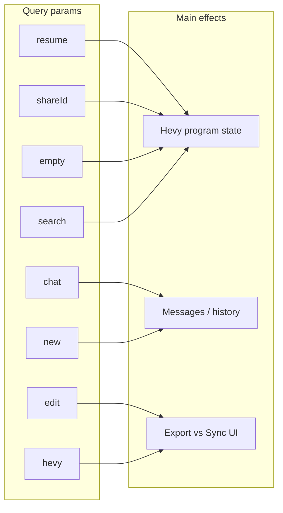

# Build-program URL query parameters reference

## Source of truth

All parameters are read client-side via `useSearchParams()`:

- [`BuildProgram.tsx`](../src/app/(app)/(with-toolbar)/build-program/BuildProgram.tsx) — `shareId`, `resume`, `empty`, `search`
- [`use-build-program-chat.ts`](../src/app/(app)/(with-toolbar)/build-program/use-build-program-chat.ts) — `search`, `shareId`, `chat`, `new`
- [`StepButton.tsx`](../src/components/program-builder/shared/StepButton.tsx) (via [`BuildProgramToolbarEnd`](../src/components/program-builder/shared/BuildProgramToolbarEnd.tsx)) — `edit` and `hevy` (Sync UI only when both are `true`)
- [`BuildProgramModeMenu.tsx`](../src/components/program-builder/shared/BuildProgramModeMenu.tsx) — `hevy` (Edit row only when `true`); `edit` when switching New vs Edit inside that session

Shared-program loading uses the same “valid `shareId`” rule as `isValidShareId` in [`BuildProgram.tsx`](../src/app/(app)/(with-toolbar)/build-program/BuildProgram.tsx) (non-empty, parses to a finite number &gt; 0). [`use-build-program-chat.ts`](../src/app/(app)/(with-toolbar)/build-program/use-build-program-chat.ts) duplicates that logic for the initial-send guard (see comment there — keep in sync with `isValidShareId`). The legacy `shared` query key is not read; old URLs that still include `shared=true` behave correctly as long as `shareId` is present.

No additional query keys are consumed by the build-program [`page.tsx`](../src/app/(app)/(with-toolbar)/build-program/page.tsx) or [`layout.tsx`](../src/app/(app)/(with-toolbar)/build-program/layout.tsx).

---

### `hevy`

- **What it does:** When `hevy=true`, the build-program session is allowed to offer **Hevy sync-to-existing** UI: the breadcrumb shows a **New / Edit** mode menu ([`BuildProgramModeMenu.tsx`](../src/components/program-builder/shared/BuildProgramModeMenu.tsx) in [`Breadcrumbs.tsx`](../src/components/program-builder/shared/Breadcrumbs.tsx)), and the toolbar can show **Sync** when `edit=true` as well ([`StepButton.tsx`](../src/components/program-builder/shared/StepButton.tsx)). Typical entry: **Edit** on a program in the profile Hevy grid ([`HevyProgramsGrid.tsx`](../src/components/program-builder/hevy/HevyProgramsGrid.tsx)) navigates with `resume=true&edit=true&hevy=true`.
- **Edge cases:** Without `hevy=true`, the mode menu is still a dropdown but only offers **New** (no Edit row). **`edit=true` alone does not enable Sync**; both `edit=true` and `hevy=true` are required.

### `edit`

- **What it does:** Together with `hevy=true`, selects **Edit (sync)** vs **New (export)** in the breadcrumb menu and switches the primary toolbar action from **Export** to a **Sync** control ([`StepButton.tsx`](../src/components/program-builder/shared/StepButton.tsx)). **Current behavior:** Sync is a **disabled** button with tooltip “Sync coming soon…”; the previous confirmation-dialog + Hevy PUT flow lives in a commented TODO block at the bottom of `StepButton.tsx` for re-enable. The menu sets or removes `edit=true` via `router.replace`, preserving other query parameters (`resume`, `hevy`, `shareId`, `chat`, `search`, etc.).
- **Edge cases:** Other values (e.g. `edit=false`) are not treated as edit mode; only the string `true` counts. Without **`both`** `edit=true` and `hevy=true`, behavior matches a normal build (**Export**). A stray `edit=true` in the URL without `hevy=true` has no effect on Sync or the mode menu until the user navigates with both flags (e.g. from [`HevyProgramsGrid.tsx`](../src/components/program-builder/hevy/HevyProgramsGrid.tsx)).

### `resume`

- **What it does:** On each change to `resume` / `shareId` / `empty`, [`BuildProgram.tsx`](../src/app/(app)/(with-toolbar)/build-program/BuildProgram.tsx) first clears program state, then when `resume=true` reads `localStorage` key `hevy-program-in-progress` and, if present, `JSON.parse`s it into editor state. Sets `resumeLoadAttemptedRef.current = true` when the `resume=true` branch runs (including when the key is missing — but not if parsing throws while the key is non-empty).
- **Edge cases:** If the key is missing, the program remains empty after the initial clear. **Malformed JSON** in that key can cause `JSON.parse` to **throw** and abort the effect before `resumeLoadAttemptedRef` is set. Debounced persistence skips clearing `hevy-program-in-progress` when `resume=true` and the program is still empty (see [`BuildProgram.tsx`](../src/app/(app)/(with-toolbar)/build-program/BuildProgram.tsx) — `localStorage` debounce around `resume === "true"`). Combining with `empty=true` is unsafe: in the same effect, **`empty` runs after `resume` synchronously** and overwrites with the empty template.

### `shareId`

- **What it does:** When present and valid (see `isValidShareId`), [`BuildProgram.tsx`](../src/app/(app)/(with-toolbar)/build-program/BuildProgram.tsx) calls `getSharedProgram(Number(shareId))` and, on success, replaces the editor program. `sharedProgramLoadAttemptedRef.current = true` is set in a `finally` on that fetch, so it is only updated when a load was **attempted** (i.e. valid `shareId`). Also used in sidebar links with `chat` to reopen a program tied to a saved chat ([`AppSidebar.tsx`](../src/components/AppSidebar.tsx) — recent chat links).
- **Edge cases:** Invalid values (empty, non-numeric, zero, or negative) do not trigger a fetch and do not flip `sharedProgramLoadAttemptedRef`. Async fetch can **race** with other program sources (`resume`, `empty`) if multiple flags are set. The first-message auto-send in `useBuildProgramChat` **defers** while `isValidShareId(shareId) && hevyProgram.length === 0 && !sharedProgramLoadAttemptedRef.current` (see [`use-build-program-chat.ts`](../src/app/(app)/(with-toolbar)/build-program/use-build-program-chat.ts)).

### `empty`

- **What it does:** When `empty=true`, seeds the editor with `emptyHevyProgram` (ordered). Also flows into `programRequest.request` via [`useProgramRequestState`](../src/app/(app)/(with-toolbar)/build-program/use-program-request-state.ts) so the agent request payload includes the `empty` flag.
- **Edge cases:** Conflicts with `resume=true` in the same navigation (empty wins synchronously after resume in the effect order). Typical entry: `/build-program?empty=true` (e.g. [`PromptTemplate.tsx`](../src/components/program-builder/shared/PromptTemplate.tsx), [`MyProgramsVault.tsx`](../src/components/programs/MyProgramsVault.tsx)).

### `search`

- **What it does:** Treated as the initial prompt text for filters/`programRequest` and, when there is no `chat` id, triggers a **single** auto-sent first user message (with optional inferred filters). Persisted debounce also prefers `search` for the stored “prompt” when present.
- **Edge cases:** If length exceeds **1800** characters from the landing prompt ([`PromptTemplate.tsx`](../src/components/program-builder/shared/PromptTemplate.tsx) — `MAX_SEARCH_URL_LENGTH`), the URL uses `search=__long_prompt__` (`LONG_PROMPT_PLACEHOLDER`) and the real text is read from `sessionStorage` (`PENDING_INITIAL_PROMPT_KEY`), then removed. Attachments may be read from `sessionStorage` (`PENDING_ATTACHMENTS_KEY`) for that send. If `chat` is set, this auto-send path is **skipped** entirely.

### `chat`

- **What it does:** Chat history id; [`useChatHistory`](../src/api/hooks.ts) loads messages and hydrates the UI when data arrives. The value is also sent as `chatSessionId` on each chat request body from [`use-build-program-chat.ts`](../src/app/(app)/(with-toolbar)/build-program/use-build-program-chat.ts).
- **Edge cases:** Disables the initial `search` auto-send (`if (chatId) return` at the start of that effect). Often paired with `shareId` from the sidebar for a full “resume conversation + program” experience.

### `new`

- **What it does:** When `new=true`, clears chat messages and **`router.replace("/build-program")`** strips the query string ([`use-build-program-chat.ts`](../src/app/(app)/(with-toolbar)/build-program/use-build-program-chat.ts)).
- **Edge cases:** User loses other params (`search`, `chat`, etc.) in one step; intended for “fresh chat” from [`AppSidebar`](../src/components/AppSidebar.tsx) (`/build-program?new=true`).

---

## Diagram

